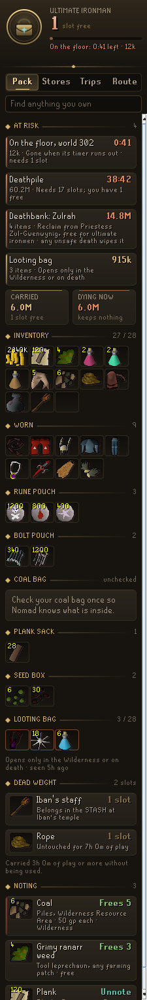
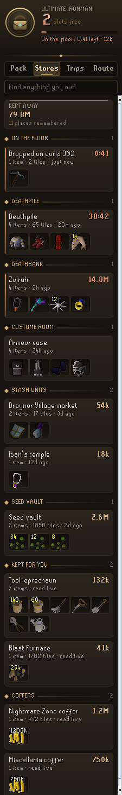
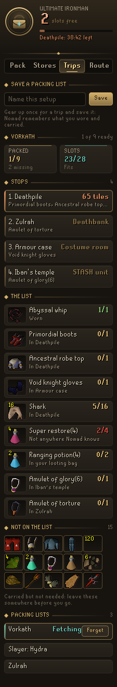
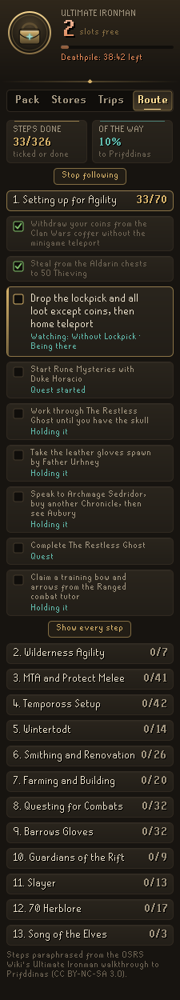
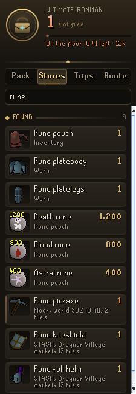

# Codex Nomad

A RuneLite plugin for ultimate ironmen. A UIM has no bank, so Nomad keeps the books a bank would: everything you carry and everywhere you have stashed things, how long each deathpile has left, what to fetch before a trip and where to fetch it, where to note and unnote, and guards against the misclicks that cost a UIM the most.

<p align="center">
  
  
  
  
  
</p>

## What it does

- **Inventory tooltips.** Hover an item in your inventory to see every other place you keep it: a deathpile, a STASH unit, the costume room or a coffer.
- **Find.** Type any item into the search box at the top and Nomad lists every place you have it, carried or kept, with how many and how far away.
- **Pack tab.** What you carry: inventory, worn items, looting bag and rune pouch, plus the herb sack, coal bag, gem bag, fish barrel, log basket, seed box, tackle box, huntsman's kit, forestry kit, chugging barrel, essence pouches, plank sack, bolt pouch, master scroll book, bow string spool and Dizana's quiver, with free slots, worth, and what a death right now would cost. An ultimate ironman keeps nothing on an unsafe death, Protect Item included, so everything counts; on other accounts the three (or four with Protect Item) items you would keep are shown by name. Whatever sits inside a bag, pouch or sack is counted as lost, since it goes with its container. Items you have not used for a while (*Dead weight after*, 3 hours by default) are marked so you know what could go into storage.
- **Stores tab.** Every place you keep things: items you dropped, deathpiles with their timers, your deathbank, the costume room in your house, STASH units, the seed vault and anything else you put away. The tool leprechaun, the Blast Furnace, fossil storage, the vyre well, Elnock's impling gear, Annette's drift nets, the pickaxe statue and the Nightmare Zone, Blast Furnace, Miscellania, Last Man Standing and Scar essence mine coffers are read straight from the game, and your servant's moneybag (up to 3M coins) and the Shilo Village furnace coffer whenever you check them. Bert's Sandstorm in Yanille, the balloon log crates, the Forestry log storage, a decayed cannon waiting with Nulodion and a weapon frozen with Eyatlalli are filed from what the game says about them. The cape on your house's cape hanger is read when the house loads. Compost bins are read whenever you pass one, so you know where your finished compost and ultracompost wait, so they are always right without a visit. Each store remembers what it holds, when it was last seen, and whether the count is exact or estimated.
- **Deathpiles that tell you when.** A deathpile lasts 60 minutes of logged-in time. Nomad counts it down, warns you in chat when it is close to gone (*Deathpile warning*, 10 minutes by default), and marks the tile on the world map. Each pile says how many slots picking it up takes, and when you lack the room, which of your cheapest things to drop first.
- **Dropped items with a timer.** Drop something and Nomad keeps it in the Stores tab with the exact second it vanishes, which world it is on, a countdown on its tile, and a warning in chat before it goes (*Dropped item warning*, 30 seconds by default).
- **Deaths, judged.** When you die, Nomad works out where your items went: kept, a deathpile on the floor, or a deathbank behind a boss (Zulrah, Vorkath, Hydra, Nightmare, Nex, the Theatre of Blood, the Tombs of Amascut, the Volcanic Mine and more), and files them there. Each deathbank says who holds it and the fee (Torfinn for 100k at Vorkath, free from Priestess Zul-Gwenwynig at Zulrah), and warns when you carry fewer coins than the fee. The deathbank count becomes exact as soon as you open the retrieval window.
- **Trips tab.** Save what you are wearing and carrying as a trip. When you start it, Nomad shows what you still need and the stops to fetch it from, nearest store first, plus what you carry that the trip does not need. Potions and charged jewellery count dose for dose, so super restore(3)s stand in for (4)s. The next stop can be marked on the ground (*Mark the next stop*). If you use Codex Quartermaster, its kits appear here too: each supply ("200 hp of food") becomes the items you own that cover it, and whatever is still short asks for the best item of that kind.
- **Notes and unnotes.** For any item, where to note or unnote it near you: the tool leprechaun, Piles, Phials, the Pollnivneach banknote merchant, Tiles, the Elder Chaos druid, or your house servant, with the cost.
- **STASH reminders.** Emote clue items you carry are matched to the STASH units they belong in, so you can put them away and stop carrying them.
- **Guards.** Hides *Destroy* on the looting bag wherever destroying it would delete what is inside: outside the Wilderness, in the Ferox Enclave and on the first two tiles past the ditch (*Looting bag Destroy*). Where *Destroy* does drop the contents, Nomad names the food and potions inside that would be lost, and *Sell* on items worth more than a set amount in shops (*Shop Sell*, *Protect items over* 50,000 gp). On the way into the Wilderness, Nomad says what a death there would cost: your deathbank, and everything you carry (beyond the items you keep, on other accounts). Walking into a boss lair while your deathbank waits somewhere else, it reminds you that a death here would wipe it. Taking damage with a deathbank waiting, anywhere a death is not safe, turns the plaque red and sends a notification, at most once a minute (*Danger warnings*).
- **The Chambers of Xeric floor.** Things you drop in a raid are kept as a store of their own with no timer, since they last the whole raid. While any lie there, the ways out are outlined in red with what you left and its worth, and leaving takes a right-click (*Chambers of Xeric floor*). If you leave anyway, Nomad says what was lost.
- **Who holds your deathbank.** While a deathbank waits, whoever holds it (Torfinn, Priestess Zul-Gwenwynig, Shura, the chest outside the Theatre of Blood and the rest) is outlined in the game with *Your deathbank* above them (*Mark the next stop*).
- **Saving a deathpile comes first.** While a deathpile is ticking, the hint arrow and Shortest Path point at it, ahead of the route. With no route step in hand, they point at the next stop for your packing list.
- **Peril plaque.** A small plaque in the game view with your free slots, the value at risk and the most urgent deathpile (*Peril plaque*).
- **Route tab.** The OSRS Wiki's Ultimate Ironman walkthrough to Prifddinas, all thirteen sections from a fresh account to Song of the Elves: over 300 steps. Nomad ticks them itself. Quests, levels, quest points, unlocks, diaries and combat achievements are read from the game. Steps about items, places, coins, chat, your deathbank, where your house is and the furniture in it are watched while the step is in hand. The few it cannot see tick once you are past them. You can still tick any step by hand.
- **Guided steps, click by click.** While you follow the route, the step in hand shows on the plaque with how far away it is and which way, and is marked on the ground and the world map. In the game, Nomad highlights what to click, the way Quest Helper does: the person to talk to (outlined, with the hint arrow on them), the stall, altar, door or obstacle to use, the item to pick up off the ground, the items to buy in the shop, the item to use in your inventory, and the chat option to choose. Quest steps outline whoever starts the quest; once a quest is under way, the plaque hands you to Quest Helper for the clicks inside it. If you have the Shortest Path plugin, Nomad asks it to draw the way there (*Route arrow*, *Highlight route clicks*, *Path with Shortest Path*).

## Settings

- **Dead weight after** (3 hours): how long an item goes unused before it is dead weight.
- **Deathpile warning** (10 minutes): when to warn about a deathpile.
- **Dropped item warning** (30 seconds): when to warn about something you dropped.
- **Share with Codex** (on): share what you hold with other Codex plugins.
- **Looting bag Destroy**, **Chambers of Xeric floor** and **Shop Sell** (on), **Protect items over** (50,000 gp): the guards.
- **Danger warnings** (on): on the way into the Wilderness or a boss lair, say what dying there would cost.
- **Peril plaque**, **Mark the next stop**, **Route step on plaque** (on): what shows in the game view.
- **Route arrow**, **Highlight route clicks**, **Path with Shortest Path** (on): how the route guides you.
- **Inventory tooltips** (on): hovering an inventory item lists every other place you keep it.

## With other Codex plugins

Nomad writes what you hold everywhere to `codexnomad/holdingsV1`, in the same shape as Codex Bank Steward's `codexbanksteward/bankV1`. On an ultimate ironman with *Share with Codex* on, it also writes `bankV1` itself (only if that entry is missing or was written by Nomad), so Codex Ironworks, Quartermaster and the rest treat your stores as your bank.

## How it works

The inventory, worn items, looting bag, seed box, kits, seed vault, costume room and the deathbank retrieval window are read as they change. The rune pouch, bolt pouch, plank sack, scroll book, spool, quiver, tool leprechaun, Blast Furnace, fossil storage and coffers are read from the game's own counters. The herb sack, coal bag, gem bag and bottomless compost bucket are followed from what the game says when you check, fill or empty them, and the fish barrel and log basket from the box shown when you check them. Dropped items are matched to your Drop clicks, with the despawn time the game gives them. Deaths come from `ActorDeath`, STASH deposits and the item retrieval service from chat messages, and the account type from the ironman varbit. Worth comes from RuneLite's item manager. Everything is stored per account in the RuneLite profile config. A damaged save never stops the panel: whatever still reads is kept.

It is guidance only. It does not automate any input, send any data off the client, or read or write files. The route only points and outlines; you walk and click. The only menu changes are the two guards, which remove an option and never add or swap one.

## Credits

- STASH unit and costume room data, and which game counters hold the leprechaun, sacks, pouches and coffers, are adapted from [Dude, Where's My Stuff](https://github.com/Thource/dude-wheres-my-stuff) (BSD 2-Clause).
- The wording the game uses for the coal bag, gem bag, fish barrel and log basket follows the [Coal Bag](https://github.com/WolffTech/coal-bag-plugin), [Gem Sack](https://github.com/serenibyss/osrs-gem-sack-plugin), [Fish Barrel](https://github.com/molo-pl/runelite-plugins) and [Log Basket](https://github.com/aidanmastro/log-basket-plugin) plugins (BSD 2-Clause).
- The regions where dying is safe follow [Deathbank Utility](https://github.com/jakevollkommer/deathbank-utility) and [Item Retrieval Warning](https://github.com/zodaz/item-retrieval-warning) (BSD 2-Clause).
- The Chambers of Xeric exits follow [UIM Utilities](https://github.com/jakevollkommer/uim-utilities) (BSD 2-Clause).
- Where each quest starts comes from the first step of [Quest Helper](https://github.com/Zoinkwiz/quest-helper) (BSD 2-Clause).
- The route follows the OSRS Wiki's [Ultimate Ironman Walkthrough Guide To Prifddinas](https://oldschool.runescape.wiki/w/Guide:Ultimate_Ironman_Walkthrough_Guide_To_Prifddinas), paraphrased, under [CC BY-NC-SA 3.0](https://creativecommons.org/licenses/by-nc-sa/3.0/).

## Building

```
./gradlew build
```
